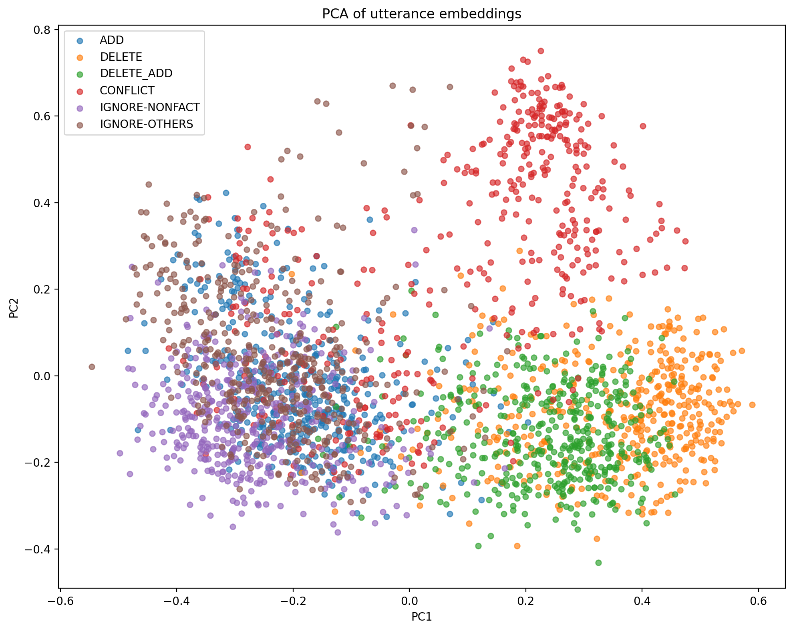

# LLM Agent Memory: Fact Consistency and Knowledge Updating

Исследование методов обнаружения противоречивых и неактуальных пользовательских фактов в долговременной памяти диалоговой системы. Сравниваются классические методы машинного обучения, zero-shot классификация с LLM, fine-tuning Transformer-модели и семантический поиск.

Проект выполнен в рамках командной курсовой работы магистратуры «Компьютерная лингвистика» НИУ ВШЭ, май 2026 г. Оригинальное название: «Обнаружение и очистка противоречивых и неактуальных фактов в базе знаний диалоговой системы».

## Постановка задачи

При поступлении новой реплики пользователя система должна определить, как изменить внешнюю базу знаний: сохранить новый факт, обновить или удалить существующий, разрешить противоречие либо оставить память без изменений.

Общая архитектура исследовательского прототипа состоит из трёх этапов:

1. Классификация операции над памятью и маршрутизация реплики.
2. Разрешение противоречий: разделение актуального и устаревшего фактов с сохранением истории изменений, если требуется.
3. Определение временного горизонта факта: `STATIC`, `SLOW_CHANGE` или `FAST_CHANGE`.

В гибридном прототипе первый этап реализован на DistilRoBERTa, второй и третий — с использованием промптов для GPT-4o-mini. Хранилище прототипа работает в памяти (in-memory).

## Мой вклад

- Разработка логики выбора операций над пользовательскими фактами и их тегирования.
- Подготовка и синтетическое расширение датасета для классификации операций над памятью.
- Проведение сравнительных экспериментов, оценка качества моделей и анализ результатов.

## Датасет

Исходные факты получены из диалоговых корпусов PersonaChat и Multi-Session Chat. Реплики для заданных операций синтетически сгенерированы с помощью Qwen 3.5 (`qwen/qwen3.5-122b-a10b`).

Файл `01_dataset_final.jsonl` содержит 2 610 примеров, по 435 на каждый из шести классов:

| Класс | Описание |
| --- | --- |
| `ADD` | Добавление нового факта о пользователе |
| `DELETE` | Удаление неактуального факта без замены |
| `DELETE_ADD` | Явная замена старого факта новым |
| `CONFLICT` | Противоречие с существующим фактом без явного маркера замены |
| `IGNORE-NONFACT` | Реплика не содержит персонального факта |
| `IGNORE-OTHERS` | Факт относится к другому человеку |

Для сравнения классификаторов использовано групповое разделение по `fact_id` (`GroupShuffleSplit`, seed 42): 2 069 обучающих и 541 тестовый пример. Дополнительно подготовлено 30 примеров вне исходного распределения (OOD). Повторная проверка разделения не обнаружила пересечений по `example_id`, `fact_id` и точным текстам, но выявила 27 общих ключей `dialogue_id + speaker`; независимое разделение по пользователям не проверено. См. `07_split_overlap_report.txt`.

## Эксперименты и результаты

### Классификация операций

Результаты на синтетической выборке (n = 541):

| Метод | Accuracy | Macro F1 |
| --- | ---: | ---: |
| TF-IDF + Logistic Regression | 0.8909 | 0.8905 |
| Qwen 3.5, prompted pair classifier | 0.8983 | 0.8980 |
| MPNet retrieval + Qwen 3.5, multifact | 0.8281 | 0.8274 |
| DistilRoBERTa, fine-tuned (standalone) | 0.9797 | 0.9798 |

DistilRoBERTa обучалась 4 эпохи с learning rate 2e-5, weight decay 0.01, batch size 8 и максимальной длиной последовательности 192 токена. В сохранённом скрипте эта же выборка используется для выбора лучшего чекпоинта по Macro F1; поэтому результат не является оценкой на независимом финальном тесте.

### Семантический поиск

Использована модель `sentence-transformers/paraphrase-multilingual-mpnet-base-v2` и косинусное сходство для поиска релевантных фактов. Исходный Recall@5 составил 0.9559 на 272 примерах обновления. В последующем multifact-эксперименте целевой факт принудительно включался в контекст, поэтому его результаты не являются оценкой полностью автономного retrieval-пайплайна.

Для анализа разнообразия датасета рассчитаны сходства ближайших соседей и построена PCA-проекция эмбеддингов.



### Интегрированный прототип

По результатам командной курсовой работы гибридный пайплайн прошёл 160 из 168 тестовых случаев (95.24%), конфигурация на GPT-4o-mini без специализированного классификатора — 119 из 168 (70.83%). Критерий успеха: совпадение операции и количества добавленных, архивированных и удалённых записей. Это результат контролируемого теста с одним исходным фактом, а не оценка качества ответов готового чат-бота.

## Ограничения

- Основная выборка синтетическая и создана одной LLM. Результаты на ней не гарантируют аналогичное качество на естественных диалогах.
- В отдельном OOD-тесте из 30 примеров multifact-вариант классификатора RoBERTa показал accuracy 0.6667.
- В интегрированном прототипе accuracy первого этапа составила 0.9464 против 0.9797 в отдельном эксперименте; различие связано с неопределённостью формата предобработки входа.
- Прототип рассчитан на одного пользователя. Многопользовательское хранение и постоянная база данных остаются направлениями дальнейшей работы.

## Содержимое репозитория

| Файл | Назначение |
| --- | --- |
| `01_dataset_final.jsonl` | Размеченные примеры |
| `02_tfidf_logreg_baseline_report.txt` | Результаты классического ML-бейзлайна |
| `03_qwen_pair_classifier_report.txt` | Zero-shot классификация Qwen |
| `04_roberta_classifier_report.txt` | Результаты fine-tuning DistilRoBERTa |
| `05_mpnet_topk_retrieval_report.json` | Метрики семантического поиска |
| `06_qwen_multifact_topk_report.txt` | Классификация с несколькими фактами в контексте |
| `embedding_diversity_report.txt` | Анализ разнообразия эмбеддингов |
| `embedding_nearest_neighbors.csv` | Ближайшие соседи |
| `embedding_similar_pairs.csv` | Семантически близкие пары |
| `embedding_pca_plot.png` | PCA-визуализация |
| `manual_eval_report.txt` | Результаты OOD-оценки |
| `07_split_overlap_report.txt` | Повторная проверка пересечений train/test |

## Запуск экспериментов

Python 3.10–3.12. Команды выполняются из корня репозитория. Исходный датасет и исторические отчёты остаются в корне; новые результаты записываются в `data/` и не перезаписывают опубликованные отчёты.

### Классический ML (CPU)

```bash
python -m pip install -r requirements-baseline.txt
python scripts/train_baseline.py
python scripts/check_split_overlap.py
```

Повторный запуск бейзлайна в окружении scikit-learn 1.8.0 дал accuracy 0.8909 и Macro F1 0.8905, совпадающие с исходным отчётом. Проверка разделения также выполнена. Нейросетевые и API-эксперименты повторно не запускались.

### Нейросетевые эксперименты

```bash
python -m pip install -r requirements.txt
python scripts/train_distilroberta.py
python scripts/analyze_embeddings.py
```

Для обучения DistilRoBERTa рекомендуется GPU. Модели скачиваются с Hugging Face. Для Qwen необходим API-ключ OpenRouter: скопируйте `.env.example` в `.env` и задайте `OPENROUTER_API_KEY`. Вызовы API могут быть платными.

```bash
python scripts/evaluate_qwen.py
```

Этот скрипт использует предсказания, сохранённые при запуске бейзлайна.

### Дополнительные материалы и ограничения воспроизводимости

`scripts/retrieve_mpnet.py` требует оригинальный файл `data/processed/base_facts_upd.jsonl`, которого нет в архиве. В `research/` сохранены дополнительные скрипты подготовки данных, генерации, multifact-экспериментов и ручной оценки. Для их запуска нужны оригинальные промежуточные датасеты, шаблоны промптов и, для OOD-оценки, веса multifact-модели. См. [research/README.md](research/README.md).

Репозиторий содержит код экспериментов первого этапа и отчёты. Код интеграции трёхэтапного командного прототипа в предоставленных материалах отсутствует. Его показатели приведены по курсовой работе. RAG-фреймворки и векторная БД в этой версии не реализованы.

## Технологии и методы

Python, TF-IDF, Logistic Regression, DistilRoBERTa, Qwen 3.5, GPT-4o-mini, Sentence Transformers, MPNet, cosine similarity, PCA, prompt engineering, fine-tuning, evaluation и OOD testing.
